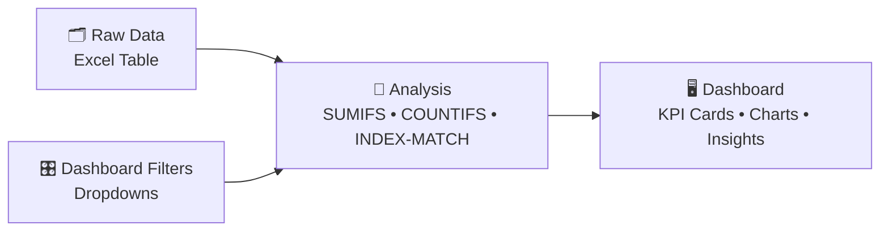

<div align="center">

# 📊 Excel Business Dashboards Collection

### Sales • HR • Marketing • Inventory • Online Retail

Five professional, interactive Excel dashboards built with **Excel Tables, formulas, charts, dropdown filters and conditional formatting**.

**5 Dashboards** | **35 Charts** | **30 KPI Cards** | **15 Filters** | **33,588 Formulas** | **0 Formula Errors**

</div>

---

## 📌 Project Overview

This project is a collection of **5 separate, fully editable Excel workbooks**. Each one takes business data and turns it into a clean dashboard that is easy to read, easy to filter and easy to present.

The goal of the project:

- 🎯 Show how raw data becomes useful business insight
- 🧮 Calculate all results with **formulas**, not typed numbers
- 🎨 Keep a **professional and consistent design** across all dashboards
- ✅ Check the main numbers against an independent calculation

---

## 🧾 Project Summary

### Project at a Glance

| Item | Details |
|------|---------|
| 📁 Workbooks | 5 separate `.xlsx` files |
| 🏢 Business areas | Sales, Human Resources, Marketing, Inventory, Online Retail |
| 🗂️ Data | 4 sample datasets created for the project + 1 sample taken from a real dataset (Online Retail II) |
| 📌 KPI cards | 30 (6 per dashboard) |
| 📈 Charts | 35, plus a Top 10 reorder table in the Inventory dashboard |
| 🎛️ Filters | 15 dropdown filters (3 per dashboard) |
| 🧮 Formulas | 33,588 formulas, all recalculated with 0 errors |
| 💡 Insights | A Key Insights panel on every dashboard that updates with the filters |

### Business Questions Answered

| Dashboard | Questions it answers |
|-----------|----------------------|
| 💰 Sales | How much revenue and profit did we make? Which region, category and product sell best? Are we growing compared with last year? |
| 👥 HR | How many employees are active? Which department loses the most people? How do salary, attendance and performance compare? |
| 📣 Marketing | Which channel gives the best return? Where is a lead cheapest? Which campaigns perform best? |
| 📦 Inventory | Which items need to be reordered now? How fast does stock turn? Which suppliers carry the most stock and the longest lead time? |
| 🛒 Online Retail | Which countries, products and customers bring the most revenue? When do customers buy (day and hour)? How big are the orders? |

### Skills Demonstrated

- 🧮 Advanced formulas: `SUMIFS`, `COUNTIFS`, `AVERAGEIFS`, `INDEX`, `MATCH`, `RANK`, `EDATE`
- 🎛️ Interactive dashboard design with dropdown filters
- 📈 Data visualization: combo, doughnut, bar, column and line charts
- 🧹 Data cleaning and sampling on a real dataset (over 1 million rows reduced to a clean sample)
- 🧪 Testing: the main numbers of every workbook were checked against an independent calculation
- 📝 Clear documentation inside every workbook

---

## 🗺️ What's Inside

| Part | Description |
|------|-------------|
| 🧾 Project Summary | Quick facts and business questions |
| 🗃️ Dashboards at a Glance | Summary table of all 5 workbooks |
| 🏗️ How Every Workbook Works | Sheet structure and data flow |
| 1️⃣ – 5️⃣ Dashboard Details | KPIs, charts, filters, data and formulas for each dashboard |
| 🎛️ How the Filters Work | The "All" wildcard trick explained |
| 🎨 Design System | Colors, fonts and layout |
| 🛠️ Excel Skills Used | Functions and tools |
| 🚀 How to Use | Step-by-step guide |
| 🧪 Testing Report | What was checked and the results |
| ⚠️ Limitations | Honest notes |
| 🔮 Future Improvements | Ideas for the next version |
| 👤 Author | Shyam Gor |

---

## 🗃️ Dashboards at a Glance

| # | Dashboard | File | Data | Period | Filters |
|---|-----------|------|------|--------|---------|
| 1 | 💰 **Sales Analysis** | `Sales_Analysis_Dashboard.xlsx` | 1,561 orders | Jan 2024 – Dec 2025 | Year • Region • Category |
| 2 | 👥 **HR Analytics** | `HR_Analytics_Dashboard.xlsx` | 320 employees | 2016 – 2026 | Department • Gender • Location |
| 3 | 📣 **Marketing Performance** | `Marketing_Performance_Dashboard.xlsx` | 267 campaign-month records | Jan 2025 – Oct 2026 | Year • Channel • Campaign Type |
| 4 | 📦 **Inventory Management** | `Inventory_Management_Dashboard.xlsx` | 72 products + 864 stock movements | Nov 2025 – Oct 2026 | Category • Supplier • Status |
| 5 | 🛒 **Online Retail Sales** | `Online_Retail_Dashboard.xlsx` | 1,439 order lines (real-data sample) | Dec 2009 – Dec 2011 | Year • Country • Quarter |

| # | KPI Cards | Charts |
|---|:---------:|:------:|
| 1 Sales | 6 | 5 |
| 2 HR | 6 | 8 |
| 3 Marketing | 6 | 8 |
| 4 Inventory | 6 | 6 + reorder table |
| 5 Online Retail | 6 | 8 |

---

## 🏗️ How Every Workbook Works

Every workbook has the same smart structure:

| Sheet | Purpose |
|-------|---------|
| 🖥️ **Dashboard** | Final view: filters, KPI cards, charts and a Key Insights panel |
| 🧮 **Analysis** | The calculation engine: every number on the dashboard comes from here |
| 🗂️ **Raw Data** | Source data stored as an Excel Table (the Inventory workbook also has a **Stock Movements** table) |
| 📝 **Notes** | How to use, definitions, data details and limitations |

**Data flow**



When you change a dropdown on the Dashboard, the Analysis sheet recalculates and every card, chart and insight updates automatically.

---

# 1️⃣ 💰 Sales Analysis Dashboard

> Track revenue, profit, orders and growth across categories, regions and products.

**🎛️ Filters:** Year • Region • Category

### 📌 KPI Cards

| KPI | Meaning |
|-----|---------|
| 💵 Total Revenue | Sum of Quantity × Unit Price × (1 − Discount) |
| 💰 Total Profit | Revenue − Cost |
| 🧾 Total Orders | Number of orders in the selection |
| 🛍️ Average Order Value | Revenue ÷ Orders |
| 📊 Profit Margin | Profit ÷ Revenue |
| 📈 YoY Revenue Growth | Latest year vs previous year |

### 📈 Charts

| # | Chart | Type |
|---|-------|------|
| 1 | Monthly Revenue & Profit Trend | Line |
| 2 | Revenue Share by Category | Doughnut |
| 3 | Region-wise Revenue & Profit | Clustered column |
| 4 | Top 10 Products by Revenue | Horizontal bar |
| 5 | Year-over-Year Revenue Growth by Month | Column |

### 💡 Key Insights Panel
Top region • Top category • Highest-margin category • Best month • #1 product

<details>
<summary>🗂️ <b>Data Dictionary (Raw Data sheet)</b></summary>

| Column | Description |
|--------|-------------|
| Order ID | Unique order number |
| Order Date | Date of the order |
| Year, Month Start | Helper formulas from the order date |
| Region | North, South, East, West |
| Category | Electronics, Furniture, Office Supplies, Apparel, Home & Kitchen |
| Product | 20 products (4 per category) |
| Segment | Consumer, Corporate, Home Office |
| Quantity, Unit Price, Unit Cost, Discount | Order inputs |
| Revenue, Cost, Profit | Calculated by formulas |

</details>

> ℹ️ The monthly trend and growth charts use the Region and Category filters only, so both years stay visible for comparison.

---

# 2️⃣ 👥 HR Analytics Dashboard

> Understand the workforce: headcount, attrition, salary, attendance and performance.

**🎛️ Filters:** Department • Gender • Location

### 📌 KPI Cards

| KPI | Meaning |
|-----|---------|
| 👥 Total Employees | All employee records (Active + Left) |
| ✅ Active Employees | Employees with status Active |
| 🚪 Attrition Rate | Employees Left ÷ Total Employees |
| 💵 Average Salary | Average annual salary of active employees |
| ⭐ Average Performance | Average rating (1–5) of active employees |
| 🕒 Average Attendance | Days Present ÷ Working Days (active employees) |

### 📈 Charts

| # | Chart | Type |
|---|-------|------|
| 1 | Department-wise Employees (Active vs Left) | Stacked column |
| 2 | Gender Distribution | Doughnut |
| 3 | Average Salary by Department | Column |
| 4 | Salary Band Distribution | Column |
| 5 | Average Attendance by Department | Column |
| 6 | Attendance Band Distribution | Column |
| 7 | Attrition Rate by Department | Column |
| 8 | Employee Performance Distribution | Column |

### 💡 Key Insights Panel
Largest team • Highest attrition • Highest average salary • Best attendance • Top performing department

<details>
<summary>🗂️ <b>Data Dictionary (Raw Data sheet)</b></summary>

| Column | Description |
|--------|-------------|
| Employee ID, Employee Name | Identity |
| Department | Sales, Operations, IT, Customer Support, Finance, Marketing, HR |
| Job Title, Gender, Location | Head Office, Regional Office, Remote |
| Hire Date, Status, Exit Date | Status is Active or Left |
| Annual Salary, Performance Rating | Salary in USD, rating from 1 to 5 |
| Working Days, Days Present | Attendance inputs |
| Attendance %, Tenure (Years) | Calculated by formulas |
| Salary Band | Under 40K, 40K-60K, 60K-80K, 80K-100K, 100K+ |
| Performance Level | Outstanding, Exceeds, Meets, Needs Improvement, Poor |

</details>

> ℹ️ Tenure is calculated from a report date that is a yellow input cell on the Analysis sheet.

---

# 3️⃣ 📣 Marketing Performance Dashboard

> Measure spend, leads, conversion and return on investment across channels and campaigns.

**🎛️ Filters:** Year • Channel • Campaign Type

### 📌 KPI Cards

| KPI | Formula |
|-----|---------|
| 💸 Total Marketing Spend | Sum of Spend |
| 🎯 Total Leads | Sum of Leads |
| 🔄 Conversion Rate | Customers ÷ Leads |
| 📈 Marketing ROI | (Revenue − Spend) ÷ Spend |
| 🏷️ Cost per Lead | Spend ÷ Leads |
| 💰 Revenue Generated | Sales from customers won through marketing |

Also calculated in the Analysis sheet: **CTR**, **ROAS** (Revenue ÷ Spend) and **Cost per Customer**.

### 📈 Charts

| # | Chart | Type |
|---|-------|------|
| 1 | Monthly Spend & Leads | Combo (columns + line) |
| 2 | Marketing Spend by Channel | Doughnut |
| 3 | Marketing ROI by Channel | Column |
| 4 | Conversion Rate by Channel | Column |
| 5 | Cost per Lead by Channel | Column |
| 6 | Top 10 Campaigns by ROI | Horizontal bar |
| 7 | Monthly Conversion Rate & Cost per Lead | Combo (two lines) |
| 8 | Leads & Customers by Channel | Clustered column |

### 💡 Key Insights Panel
Best ROI channel • Lowest cost per lead • Highest conversion rate • Top campaign by ROI • Best month for leads

<details>
<summary>🗂️ <b>Data Dictionary (Raw Data sheet)</b></summary>

| Column | Description |
|--------|-------------|
| Record ID, Month, Year | One row = one campaign in one month |
| Campaign | 15 campaigns |
| Channel | Search Ads, Social Ads, Email, SEO, Influencer, Display Ads |
| Campaign Type | Brand, Performance, Retention |
| Spend, Impressions, Clicks, Leads, Customers, Revenue | Campaign results |
| CTR, Cost per Lead, Conversion Rate, ROI | Calculated by formulas |

</details>

> ℹ️ Monthly charts use the Channel and Campaign Type filters only, so all 22 months stay visible.

---

# 4️⃣ 📦 Inventory Management Dashboard

> Control stock levels, find items to reorder and compare categories and suppliers.

**🎛️ Filters:** Category • Supplier • Status (every card, chart and table responds to all three)

### 📌 KPI Cards

| KPI | Meaning |
|-----|---------|
| 💎 Total Stock Value | Current Stock × Unit Cost |
| 📦 Total Products | Number of SKUs in the selection |
| ⚠️ Low Stock Items | Stock above 0 but at or below the reorder level |
| 🔔 Reorder Alerts | Low Stock + Out of Stock items |
| 🔁 Inventory Turnover | COGS ÷ average stock value |
| ↔️ Net Stock Movement | Units Received − Units Sold |

### 🚦 Stock Status Rules

| Status | Rule |
|--------|------|
| 🔴 Out of Stock | Current stock = 0 |
| 🟠 Low Stock | Stock above 0 and at or below the Reorder Level |
| 🔵 Overstock | Stock above 4 × the Reorder Level |
| 🟢 In Stock | Everything else |

### 📈 Charts and Table

| # | Visual | Type |
|---|--------|------|
| 1 | Monthly Stock Movement (Received vs Sold + month-end stock) | Combo |
| 2 | Stock Status Mix | Doughnut |
| 3 | Stock Value by Category | Column |
| 4 | Inventory Turnover by Category | Column |
| 5 | Stock Value by Supplier | Horizontal bar |
| 6 | Supplier Lead Time & Reorder Alerts | Clustered column |
| 7 | **Top 10 Reorder Alerts** (most urgent first) | Table with red / orange status tags |

### 💡 Key Insights Panel
Largest category by stock value • Fastest-turning category • Supplier with most reorder alerts • Longest supplier lead time • Most urgent item

<details>
<summary>🗂️ <b>Data Dictionary (2 tables)</b></summary>

**Raw Data (one row per product)**

| Column | Description |
|--------|-------------|
| SKU, Product, Category, Supplier | Product details (72 products, 6 categories, 6 suppliers) |
| Unit Cost, Opening Stock | Inputs |
| Units Received, Units Sold | Calculated from the Stock Movements table |
| Current Stock | Opening Stock + Received − Sold |
| Reorder Level, Reorder Qty, Lead Time (Days) | Inventory settings |
| Stock Value, Opening Value, COGS, Turnover | Calculated by formulas |
| Stock Status, Reorder Alert, Days of Cover | Calculated by formulas |

**Stock Movements (one row per product per month)**

| Column | Description |
|--------|-------------|
| Month, SKU | Nov 2025 – Oct 2026 |
| Units Received, Units Sold | Monthly movement |
| Category, Supplier, Stock Status | Looked up from Raw Data by formula |

</details>

---

# 5️⃣ 🛒 Online Retail Sales Dashboard (Real Data Sample)

> A dashboard built from a real dataset: the **Online Retail II** data (mostly United Kingdom sales).

**🎛️ Filters:** Year • Country • Quarter  |  **💷 Currency:** British Pounds (£)

### 📌 KPI Cards

| KPI | Meaning |
|-----|---------|
| 💷 Total Revenue | Quantity × Unit Price |
| 🧾 Total Orders | Unique invoice numbers |
| 👤 Customers | Unique Customer IDs with sales |
| 🛍️ Average Order Value | Revenue ÷ Orders |
| 💎 Revenue per Customer | Revenue ÷ Customers |
| 📦 Products Sold | Number of different products sold |

### 📈 Charts

| # | Chart | Type |
|---|-------|------|
| 1 | Monthly Revenue & Orders | Combo (columns + line) |
| 2 | Top 8 Countries by Revenue | Horizontal bar |
| 3 | Top 10 Products by Revenue | Horizontal bar |
| 4 | Revenue by Day of Week | Column |
| 5 | Top 10 Customers by Revenue | Horizontal bar |
| 6 | Monthly Average Order Value | Line |
| 7 | Revenue by Hour of Day | Column |
| 8 | Orders by Order Value | Column |

### 🧹 How the Real Data Was Prepared

| Step | Detail |
|------|--------|
| 1️⃣ Original file | 1,067,371 rows (two sheets: 2009–2010 and 2010–2011) |
| 2️⃣ Cleaning | Removed cancelled orders, zero or negative quantity or price, rows without a Customer ID, and non-product codes (postage, bank charges, manual entries) |
| 3️⃣ Sampling | Random **whole orders** with up to 8 lines each. Each month's number of orders follows the real monthly pattern. About 12% of orders are from outside the UK |
| 4️⃣ Final sample | **1,439 rows • 379 orders • 311 customers • 815 products • 11 countries** |

> ⚠️ Because this is a small sample, totals are **not** the real company totals, and very large wholesale orders are not included. The dashboard shows analysis skills, not real company figures.

<details>
<summary>🗂️ <b>Data Dictionary (Raw Data sheet)</b></summary>

| Column | Description |
|--------|-------------|
| Invoice, Stock Code, Description | Order and product |
| Quantity, Unit Price | Order inputs |
| Invoice Date, Customer ID, Country | Order details |
| Revenue | Quantity × Unit Price |
| Year, Month Start, Quarter, Weekday, Hour | Helper formulas from the invoice date |
| Order Flag | 1 for the first line of each invoice (used to count unique orders) |
| Order Value | Total value of the invoice (on the first line only) |

</details>

> ℹ️ Monthly charts use the Country filter only, so all 25 months stay visible.

---

## 🎛️ How the Filters Work

Each filter is a **dropdown cell** (yellow) on the Dashboard. Formulas on the Analysis sheet read the selected value:

| You choose | Criteria used in the formula |
|------------|------------------------------|
| `All` | `*` (the wildcard: matches every value) |
| A real value, e.g. `West` | That exact value |

So one formula such as `SUMIFS` works for both cases: "All regions" and "West only". For the **Year** filter, `All` becomes a range from `0` to `9999`.

---

## 🎨 Design System

| Element | Choice |
|---------|--------|
| Layout | Clean 12-column grid, one filter bar, 6 KPI cards, then charts |
| Font | Arial |
| Navy | `#1F2A44` – titles and headers |
| Teal | `#0FA3B1` – main accent |
| Blue | `#2F6FED` |
| Green | `#10B981` – positive values |
| Orange | `#F59E0B` – filters and highlights |
| Purple | `#7C3AED` |
| Red | `#DC2626` – negative values and alerts |
| Filter cells | Yellow, so they are easy to find |

---

## ✨ Features

- 🎛️ Interactive dropdown filters on every dashboard
- 🧱 Excel Tables for clean, expandable data
- 🧮 All results calculated by formulas
- 📈 Combo charts (columns + line on a second axis), doughnut, bar and line charts
- 🎨 Conditional formatting (data bars, red / green values, status tags)
- 💡 Key Insights panel that updates with the filters
- 🏆 Dynamic Top 10 rankings using RANK, INDEX and MATCH
- 📝 A Notes sheet inside every workbook
- 🖨️ Print area and page setup included on every dashboard

---

## 🛠️ Excel Skills Used

| Area | Functions / Tools |
|------|-------------------|
| Aggregation | `SUMIFS`, `COUNTIFS`, `AVERAGEIFS`, `COUNTIF`, `SUM` |
| Lookup & Ranking | `INDEX`, `MATCH`, `RANK`, `SMALL`, `MAX`, `MIN` |
| Dates | `DATE`, `EDATE`, `YEAR`, `MONTH`, `WEEKDAY`, `HOUR`, `TEXT` |
| Logic | `IF`, `IFERROR`, `AND`, `CHOOSE`, `VALUE`, `ROUNDUP` |
| Filters | Data Validation dropdowns with wildcard criteria |
| Visuals | KPI cards, combo charts, doughnuts, bar charts, conditional formatting, data bars |
| Data | Excel Tables and a clean flow: Raw Data → Analysis → Dashboard |

---

## 🚀 How to Use

1. Open any `.xlsx` file in **Microsoft Excel**.
2. Go to the **Dashboard** sheet.
3. Click a **yellow cell**, then click the small arrow and choose a value (Year, Region, Country, etc.).
4. Choose **All** to remove a filter.
5. KPI cards, charts and insights update automatically.

**To use your own data**

1. Paste your data into the **Raw Data** sheet.
2. Copy the formula columns down to the last row.
3. Update the category / product / country lists on the **Analysis** sheet and the dropdown lists on the Dashboard.
4. The Analysis formulas read down to a fixed row limit (see the Notes sheet of each workbook).

---

## 📁 Files

```
📦 Excel Business Dashboards
 ┣ 📄 README.md
 ┣ 📊 Sales_Analysis_Dashboard.xlsx
 ┣ 📊 HR_Analytics_Dashboard.xlsx
 ┣ 📊 Marketing_Performance_Dashboard.xlsx
 ┣ 📊 Inventory_Management_Dashboard.xlsx
 ┗ 📊 Online_Retail_Dashboard.xlsx
```

---

## 🧪 Testing Report

| Workbook | Formulas | Formula Errors | Checked Against Independent Calculation |
|----------|:--------:|:--------------:|-----------------------------------------|
| Sales | 8,221 | ✅ 0 | KPIs, categories, regions, Top 10, monthly growth, filter combination |
| HR | 1,435 | ✅ 0 | KPIs, department, gender, salary / attendance / performance bands, filter combination |
| Marketing | 1,837 | ✅ 0 | KPIs, channels, Top 10 campaigns, monthly figures, filter combination |
| Inventory | 3,837 | ✅ 0 | KPIs, categories, suppliers, monthly movement, reorder ranking, two filter combinations |
| Online Retail | 18,258 | ✅ 0 | KPIs, monthly, countries, products, customers, weekday, hour, order bands, two filter combinations |
| **Total** | **33,588** | ✅ **0** | |

The dashboard layouts were also viewed as rendered images to check how they look.

---

## ⚠️ Limitations

- Filters are **dropdown cells with formulas**. Native Excel **Slicers** and **PivotTables** are not used.
- Chart titles are fixed text and do not show the selected filter.
- Dashboards 5 totals are **not** the real company totals (small sample of the real dataset).
- Product, customer, category and country lists on the Analysis sheets are fixed to the sample data. Update them if you replace the data.
- Tested by recalculating in LibreOffice and checking the numbers. The layout may look slightly different in some Excel versions.

---

## 🔮 Future Improvements

- 🔘 Add real Excel **Slicers** and **PivotTables**
- ⚡ Use **Power Query** to load and clean large datasets automatically
- 📉 Add forecasting (trend lines for revenue and leads)
- 🧩 Use dynamic array functions (`FILTER`, `UNIQUE`, `SORT`) in newer Excel versions
- 📱 Create a compact mobile-friendly view

---

## 👤 Author

**Shyam Gor**

---

<div align="center">

### ⭐ Thank you for checking out this project! ⭐

</div>
